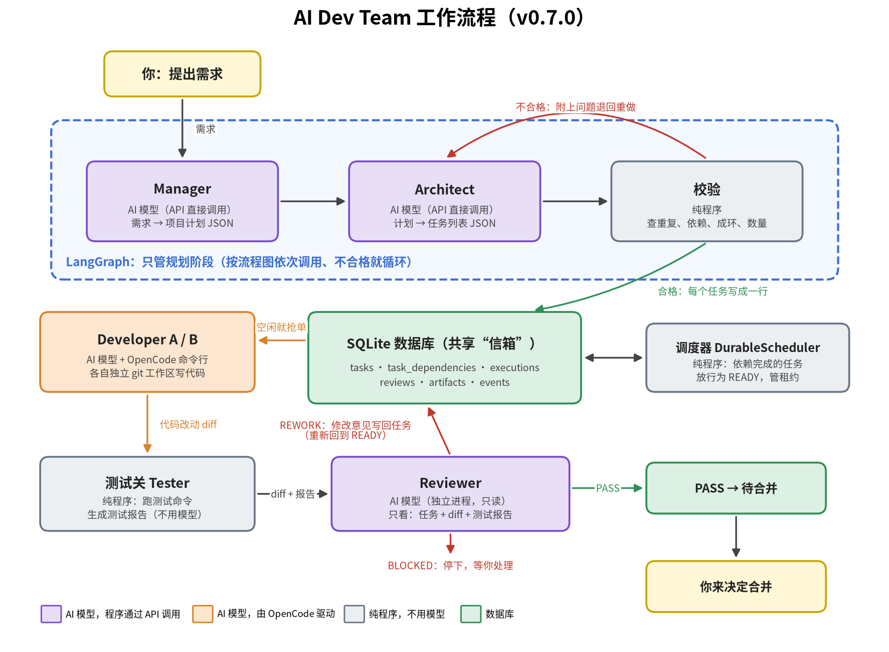

# AI Dev Team

## Desktop app (macOS, Windows, Linux)

Download the build for your system from the repo's Releases (or a pull request's
Actions artifacts). Python is included; you only need OpenCode and git installed.

- macOS: open the `.dmg`, drag AI Dev Team to Applications. It is not signed yet, so
  the first time right-click it and choose Open.
- Windows: unzip, run `AI Dev Team.exe` (SmartScreen: More info, Run anyway).
- Linux: untar, run `ai-dev-team/ai-dev-team`.

Build one yourself on that system: `pip install -e '.[package]'` then
`python packaging/desktop/build.py --smoke`. Publish all three: push a tag like `v0.7.0`.

A lightweight, local-first multi-agent software development orchestrator for macOS Apple Silicon.
Cloud model APIs only; no local LLMs. Version 0.7.0 implements P0 to P7 (see
`docs/IMPLEMENTATION_PLAN.md`). Real model and real OpenCode runs still have to be checked
on your Mac. The tests use a fake OpenCode binary and a fake review verdict.

## How it works



LangGraph only runs the planning loop (Manager → Architect → validation, back to the
Architect when the task graph is rejected). After that, SQLite is the shared state: the
scheduler marks tasks READY, idle Developers claim them, the test gate and the Reviewer
decide PASS / REWORK / BLOCKED, and you merge.

## Roles

| Agent | Default model | Job |
|---|---|---|
| Manager | Qwen4-Max (DashScope) | turns a request into a plan |
| Architect | DeepSeek-V4-Pro | builds a dependency-checked task DAG |
| Developer A/B | DeepSeek-V4.1-Flash through OpenCode | write code, one worktree per task, 2 in parallel |
| Reviewer | DeepSeek-V4-Pro, separate process | reads the diff and the test report, has a veto |
| Scheduler | (code, no model) | leases, retries, state machine, merge queue |

## Install

```bash
cd ~/code/ai-dev-team
python3.12 -m venv .venv && source .venv/bin/activate
pip install -U pip && pip install -e '.[dev]'
pytest                      # 66 passed
```

## Mac app (one page for everything)

```bash
./packaging/macos/build_app.sh --install     # then double-click "AI Dev Team"
```

The app opens one local page with three tabs: **项目与运行** (add a project, plan, run, merge,
live logs, stop), **看板** and **模型设置**. See `docs/MAC_APP.md` for details. The app can't go
on the Mac App Store because the sandbox forbids running git, OpenCode and swift on your repos.
Use the script build, or `--dmg` and `--sign` for Developer ID distribution.

## Set up models and keys

```bash
ai-dev-team ui              # http://127.0.0.1:8765/?token=...  settings + /dashboard
```

On that page, set each agent's model, fallbacks and reasoning level. Paste each API key there:
it is stored in `~/.ai-dev-team/secrets.env` with mode 600, and environment variables take
priority over it. Press **测试** to make one real call per model. Saving runs the same checks
as the CLI: the Manager and the Reviewer can't use the same model, and the Reviewer never
falls back to the Manager's model.

```bash
ai-dev-team init            # create/upgrade the DB, register agents
ai-dev-team config-check    # keys + OpenCode present? (calls no model)
ai-dev-team opencode-check  # OpenCode version, supported flags, model ids it knows
```

If OpenCode spells a model differently (`opencode models`), map it under **OpenCode → 模型名映射**
in the page, or under `opencode.model_map` in `config/agents.yaml`.

## The target repo (MiniTot)

Commit an `.ai-dev-team.yaml` at the root of MiniTot. For a Swift Package:

```yaml
test_commands:
  - swift test
test_timeout_s: 1200
```

## Run

```bash
ai-dev-team project-add minitot ~/code/MiniTot
ai-dev-team plan minitot "给 MiniTot 增加 ..." --no-save   # preview Manager + Architect output
ai-dev-team plan minitot "给 MiniTot 增加 ..."             # save the task DAG
ai-dev-team run minitot --dry-run                         # scheduling only, no code touched
ai-dev-team run minitot --opencode                        # the real thing
ai-dev-team tasks minitot ; ai-dev-team events <task>
ai-dev-team integration minitot                           # what is ready for you to merge
```

### What `run --opencode` does with each task

1. Creates the worktree `~/.ai-dev-team/worktrees/minitot/<task>` on branch `aidt/minitot/<task>`.
   The branch starts from `aidt/minitot/integration`, so it already contains the finished
   tasks it depends on.
2. Runs `opencode run --model ... --standalone --auto --archived "<prompt>"` with the worktree
   as its working directory. Two Developers run in parallel at most. On timeout, the whole
   process group is killed.
3. Test gate: runs `swift test` in that worktree. API keys are removed from the test environment.
4. Reviewer, in a separate process, reads only the task, the acceptance criteria, earlier
   fixes, the diff and the test report. Hard rules can turn its PASS into REWORK. REWORK
   sends the task back with concrete fixes. After 3 reworks the task is BLOCKED and the
   Manager is asked to re-plan.
5. Merge queue, one task at a time, into `aidt/minitot/integration` with `--no-ff`. If the
   merge conflicts, the task goes back to the Developer with the conflict markers in its
   worktree. Then `swift test` runs on integration. If it fails, the merge is undone and the
   task goes back for rework. Only after both pass is the task marked COMPLETED and its
   worktree removed.
6. **`main` is never checked out, committed, reset or merged into.** You review
   `aidt/minitot/integration` and merge it yourself:
   `git -C ~/code/MiniTot merge --no-ff aidt/minitot/integration`.

### After a crash or Ctrl+C

`ai-dev-team run ... --opencode` picks up where it stopped. Expired leases go back to READY.
Tasks left in TESTING, REVIEWING or MERGE_QUEUED are finished without redoing the
Developer's work. A merge left half done on integration is aborted first. A worktree
that was deleted or broken is rebuilt from its branch. To do these steps by hand:
`ai-dev-team recover` (leases), `ai-dev-team review <task>` and `ai-dev-team merge <project>`.

## Other commands

`review <task>` re-runs the test gate and the Reviewer, which also retries a review that
errored. `test-check --workspace DIR` runs the tests only. `agents` shows the configured
agents. `status` shows a summary.

## Notes for an 8 GB Mac

- The first `swift test` in each new worktree builds from scratch. Keep `test_timeout_s` generous.
- `defaults.max_concurrency: 2` is the ceiling. Use 1 if builds swap.
